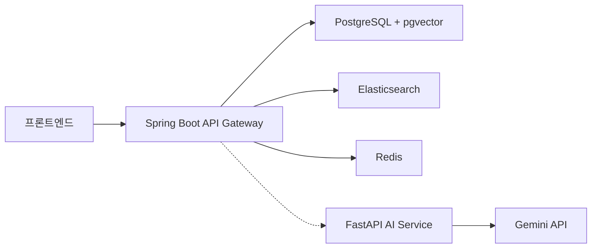
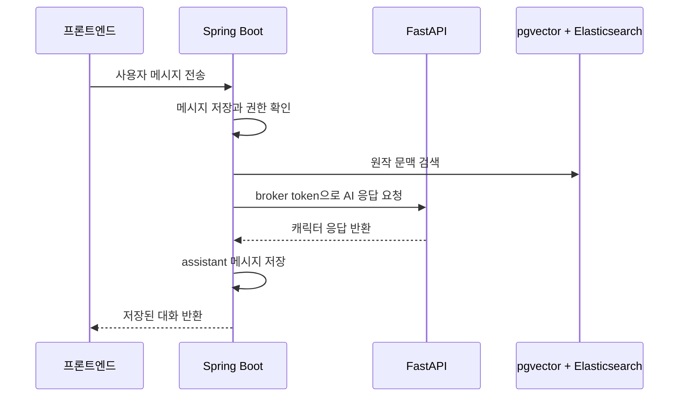
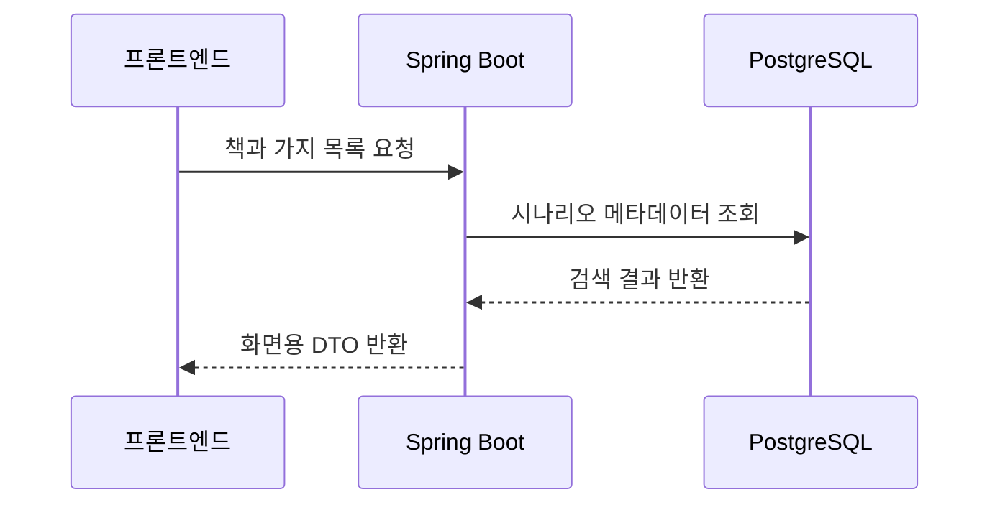
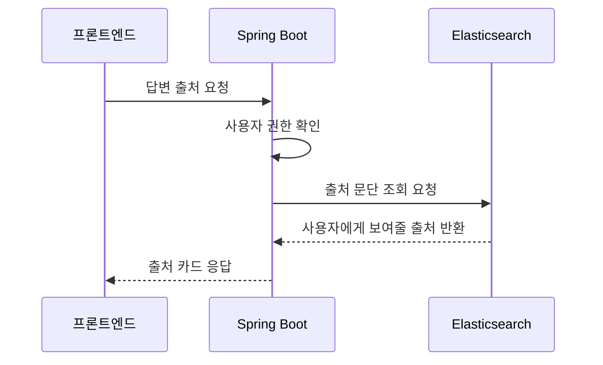

# Gaji Backend

Gaji의 Spring Boot API 서버입니다. 프론트엔드의 단일 진입점으로 동작하며, 사용자, 책, 시나리오, 대화, 소셜 데이터와 PostgreSQL/pgvector 기반 RAG 데이터를 관리합니다.

현재 코드는 AI 응답 생성과 일부 RAG 오케스트레이션을 내부 FastAPI 서비스에 위임하는 과도기 구조를 포함합니다. 신규 저장소 방향은 ChromaDB가 아니라 PostgreSQL `pgvector`와 Elasticsearch입니다.

## 역할

- 로그인과 JWT 인증을 처리합니다.
- 책, 시나리오, 대화, 메모, 좋아요, 팔로우 데이터를 관리합니다.
- 프론트엔드가 호출하는 API의 단일 진입점 역할을 합니다.
- 소설 문단 임베딩은 PostgreSQL `pgvector`에 저장하고 의미 검색에 사용합니다.
- Elasticsearch를 사용해 BM25 검색, 출처 조회, 대화 메시지 검색을 보완합니다.
- AI 작업이 필요한 요청은 현재 FastAPI 서비스로 전달하며, FastAPI 제거 후에는 Spring Boot 경계 안에서 Gemini 호출과 검색 오케스트레이션을 수행합니다.
- PostgreSQL, Elasticsearch, Redis를 사용해 서비스 데이터를 저장하고 조회합니다.

## 담당 기능

| 도메인 | 기능 |
| --- | --- |
| 인증 | 회원가입, 로그인, JWT 인증, 사용자 식별 |
| 콘텐츠 | 책 메타데이터, 좋아요한 책, 댓글 흐름 |
| 시나리오 | What-if 가지 생성, 상세 조회, 트리/분기 관계 관리 |
| 대화 | 대화 생성, 메시지 저장, AI 응답 요청, 대화 포크 |
| 소셜 | 대화 좋아요, 팔로우, 프로필 활동 정보 |
| 검색 | 책, 시나리오, 대화, 사용자 통합 검색 |
| RAG/Search | pgvector 의미 검색, Elasticsearch BM25/출처/메시지 검색 |
| AI Gateway | 과도기 FastAPI 호출용 내부 token 발급과 AI 응답 프록시 |

## 요청 흐름



| 서비스 | 직접 접근하는 저장소 | 책임 |
| --- | --- | --- |
| Spring Boot | PostgreSQL/pgvector, Elasticsearch, Redis | 인증, 도메인 CRUD, 대화 저장, 소셜 기능, 검색 저장소, API Gateway |
| FastAPI | Gemini, PostgreSQL/pgvector, Elasticsearch | 과도기 AI/RAG 오케스트레이션 |
| Frontend | 없음 | UI와 API 호출 |

ChromaDB/Pinecone은 기본 RAG 저장소가 아닙니다. 레거시 컬럼이나 import 경로가 남아 있더라도 신규 RAG 저장소는 `rag_passages`의 `pgvector` 임베딩과 Elasticsearch 색인을 기준으로 합니다.

## 설계 이유

- 사용자, 대화, 좋아요, 팔로우처럼 관계와 권한이 중요한 데이터는 Spring Boot가 일관되게 관리합니다.
- 원작 문맥 검색은 PostgreSQL/pgvector와 Elasticsearch로 단순화해 운영 컴포넌트를 줄입니다.
- 캐릭터 답변 생성처럼 AI provider에 의존하는 작업은 현재 FastAPI 경유가 남아 있지만, FastAPI 제거 후에는 Spring Boot가 검색 결과를 조합해 Gemini 호출을 수행하는 방향입니다.
- 프론트엔드는 Spring Boot만 호출하므로 인증, 로깅, 오류 응답의 경계를 한 곳에서 유지할 수 있습니다.

## 기술 구성

| 영역 | 사용 기술 |
| --- | --- |
| 언어 | Java 21 |
| 프레임워크 | Spring Boot 3.5.2 |
| 데이터 접근 | Spring Data JPA, QueryDSL, PostgreSQL, pgvector |
| 인증 | Spring Security, JWT |
| 연동 | WebClient, Redis, Elasticsearch |
| 마이그레이션 | Flyway |
| 빌드 | Gradle multi-module |

## 모듈 구조

```text
gajiBE/
├── apps/
│   ├── api-app/          # 실행 가능한 API 애플리케이션
│   ├── batch-app/        # 배치 애플리케이션 영역
│   └── admin-app/        # 관리 애플리케이션 영역
├── domains/
│   ├── auth-domain/
│   ├── content-domain/
│   ├── scenario-domain/
│   ├── chat-domain/
│   ├── social-domain/
│   ├── search-domain/
│   └── ai-domain/
├── shared-kernel/        # 공용 타입과 도메인 primitive
├── src/main/resources/   # 공용 설정과 migration
└── build.gradle
```

현재 실행 가능한 애플리케이션은 `apps:api-app`입니다. 도메인 모듈은 `api-app`의 source set에 포함되어 함께 컴파일됩니다.

## 실행과 검증

```bash
./gradlew :apps:api-app:bootRun --args='--spring.profiles.active=dev'
```

기본 포트는 `8080`입니다.

## 주요 명령어

| 명령어 | 설명 |
| --- | --- |
| `./gradlew :apps:api-app:bootRun` | API 서버 실행 |
| `./gradlew :apps:api-app:test` | API app 테스트 |
| `./gradlew :apps:api-app:build` | API app 빌드 |
| `./gradlew :apps:api-app:bootJar` | 실행 가능한 jar 생성 |

루트 Gradle task 일부는 phase-1 모듈 분리 정책 때문에 비활성화되어 있습니다. 실행/테스트는 `:apps:api-app:*` task를 우선 사용합니다.

## 핵심 처리 흐름

### 캐릭터 대화



### 시나리오 탐색



### RAG 출처 조회



## 구현 기준

- DB schema 변경은 Flyway migration으로 관리합니다.
- AI 호출은 가능한 한 DB transaction 밖에서 처리합니다.
- 느린 AI 응답과 중복 클릭을 고려해 idempotency, pending state, retry boundary를 명확히 유지합니다.
- 사용자에게 노출되는 응답에는 내부 오류 메시지나 디버깅 용어가 섞이지 않도록 합니다.
